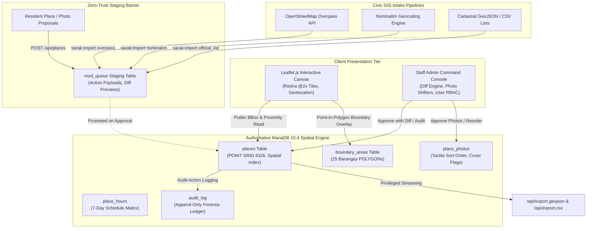

<div align="center">

# 🗺️ SARAK ATLAS

### *The High-Precision Spatial Directory & Verified Civic Cartography Platform*

> Grounded in the heart of **Bangued, Abra**, **Sarak** transforms fragmented local knowledge into an audited, high-precision geospatial atlas. Powered by spatial geometry, a zero-trust moderation barrier, and automated GIS pipelines.

<br />

[](https://sarak.free.nf)
[](https://laravel.com)
[](https://mariadb.com)
[](https://leafletjs.com)
[](#-verification--rigorous-testing)
[](#-open-data-rails)
[](LICENSE)

<br />

[Overview](#-overview) • [System Architecture](#-system-architecture--spatial-topology) • [Core Invariants](#-inviolable-system-invariants) • [Role Hierarchy](#-role-hierarchy--governance-matrix) • [API Reference](#-api-surface--open-data-rails) • [Quickstart](#-installation--quickstart) • [Ingestion Pipelines](#-geospatial-ingestion-pipelines) • [Test Verification](#-verification--rigorous-testing) • [License](#-license--attribution)

---

</div>

## 💡 Overview

**Sarak** (`sarak.free.nf`) is an interactive geospatial atlas cataloging essential institutions—fast food chains, hospitals, pharmacies, groceries, and coffee shops—across the **25 barangays of Bangued, Abra**.

While conventional directories rely on brittle unverified crowdsourcing or flat lat/lng columns, **Sarak** is engineered as an immutable civic cartography engine:

1. **Native Spatial Geometry Engine:** Houses coordinates in native MariaDB SRID 4326 `POINT` geometries and barangay administrative territories in `POLYGON` geometries, computing viewport bounding boxes (`MBRContains`) and radial proximity distances (`ST_Distance_Sphere`) in sub-105ms queries over thousands of entities.
2. **Zero-Trust Moderation Quarantine Barrier:** Community submissions never touch live database tables directly. Every proposed listing, photo, coordinate move, or edit stages in `mod_queue` for side-by-side before/after diff audit review.
3. **Dual-Surface Administrative Governance:** Administrators command listings either through the dedicated high-density desktop console or directly on the public map canvas via live session telemetry.
4. **Automated Open GIS Pipelines:** Artisan intake daemons harvest OpenStreetMap Overpass POIs, Nominatim geocoder queries, and municipal cadastral registers with automated spatial deduplication.

---

## 🏛️ System Architecture & Spatial Topology

The Sarak platform decouples public read projections from write mutations through an isolated moderation staging pipeline and append-only audit trail:



---

## 🛡️ Inviolable System Invariants

The platform enforces five bedrock architectural invariants verified by the test suite:

- **Invariant I: Zero Unapproved Mutations on Public Reads**  
  No unapproved row, pending submission, or rejected photographic asset can ever be reflected on public read endpoints (`/api/places`, `/api/places/{id}`). The public read projection is strictly insulated.
- **Invariant II: Root Admin Sovereignty & Account Immunity**  
  The Head Administrator account (`admin@bangued.ph`) possesses irrevocable rank (`rank = 2`). The system mathematically rejects any role demotion or account deletion attempt targeting the head administrator (`422 Unprocessable Entity`), eliminating lockout vulnerabilities.
- **Invariant III: Mathematical Point-in-Polygon Boundary Containment**  
  Every establishment pin is topologically validated against the 25 official Bangued barangay administrative boundary polygons using `ST_Contains(boundary.geom, place.geom)`. Anomaly scans and batch repair pipelines automatically re-anchor drifting pins to their valid political subdivision.
- **Invariant IV: Anti-Gaming Contributor Karma Integrity**  
  User reputation karma is accrued **exclusively** upon proposing a new place that successfully passes administrator diff review (+20 karma). Proposing edits, uploading photos, submitting incident reports, or claiming business listings yield exactly 0 karma.
- **Invariant V: Append-Only Forensic Audit Supervision**  
  Every staff administrative action—coordinate moves, metadata updates, photo deletions, entity merges, role promotions, and account purges—is committed to an append-only `audit_log` with before/after JSON diffs.

---

## 👥 Role Hierarchy & Governance Matrix

```
                          ┌───────────────────────────────┐
                          │          HEAD ADMIN           │
                          │   Root Sovereign & Anchor     │
                          │     (admin@bangued.ph)        │
                          └──────────────┬────────────────┘
                                         │
                                         ▼
                          ┌───────────────────────────────┐
                          │             ADMIN             │
                          │     Deputy Cartographer       │
                          │    & Moderation Reviewer      │
                          └──────────────┬────────────────┘
                                         │
                         ┌───────────────┴───────────────┐
                         ▼                               ▼
            ┌─────────────────────────┐     ┌─────────────────────────┐
            │          USER           │     │          GUEST          │
            │ Registered Contributor  │     │ Unauthenticated Visitor │
            │    & Verified Owner     │     │   & Wayfinding Citizen  │
            └─────────────────────────┘     └─────────────────────────┘
```

| Operational Capability | Guest | Resident (User) | Staff Admin | Head Admin |
| :--- | :---: | :---: | :---: | :---: |
| **Interactive Map & Viewport Pan/Zoom** | ✅ Full Read | ✅ Full Read | ✅ Full Read | ✅ Full Read |
| **Turn-by-Turn Routing & Directions** | ✅ Full Read | ✅ Full Read | ✅ Full Read | ✅ Full Read |
| **View Place Details & Photo Lightbox** | Approved Only | Approved Only | All Statuses | All Statuses |
| **Submit New Place Proposal** | ❌ (Auth Modal) | ⏳ Staged to `mod_queue` | ⚡ **Direct Publish** | ⚡ **Direct Publish** |
| **Propose / Upload Place Photos** | ❌ (Auth Modal) | ⏳ Staged to `mod_queue` | ⚡ **Direct Ingestion**| ⚡ **Direct Ingestion**|
| **Manual Photo Reordering (`sort_order`)**| ❌ | ❌ | ✅ Tactile Shifters | ✅ Tactile Shifters |
| **Designate Primary Cover Photo** | ❌ | Own Uploads Only | **Any Place Image** | **Any Place Image** |
| **Evict / Delete Photographic Assets** | ❌ | Own Uploads Only | 🗑️ **Dual-Surface Purge**| 🗑️ **Dual-Surface Purge**|
| **Single-Pin Precision Relocation** | ❌ | ⏳ Staged to `mod_queue` | 📍 **Drag-and-Drop** | 📍 **Drag-and-Drop** |
| **Batch Macro-Drift Mass Relocation** | ❌ | ❌ | 🌐 **Batch Vector Shift**| 🌐 **Batch Vector Shift**|
| **Moderation Queue Diff Review & Merge**| ❌ | ❌ | ✅ Full Authority | ✅ Full Authority |
| **Verified Merchant Ownership Claim** | ❌ | ✅ Request Claim | Admin Reassign | Admin Reassign |
| **Administrative Boundary Anomaly Fix** | ❌ | ❌ | 🔧 Batch Containment | 🔧 Batch Containment |
| **Trigger Geospatial Ingestion Jobs** | ❌ | ❌ | 📡 Overpass / Nominatim | 📡 Overpass / Nominatim |
| **Export GIS Datasets (GeoJSON / CSV)** | ❌ | ❌ | 📥 Privileged Export | 📥 Privileged Export |
| **Promote User to Staff Admin** | ❌ | ❌ | ❌ **Blocked (403)** | 👑 **Sole Authority** |
| **Demote Staff Admin to User** | ❌ | ❌ | ❌ **Blocked (403)** | 👑 **Sole Authority** |
| **Account Demotion & Deletion Immunity**| N/A | N/A | ❌ | 🛡️ **Permanent Invariant**|

---

## 🔌 API Surface & Open Data Rails

### Public Read API (Zero Authentication Required)

- `GET /api/categories` $\rightarrow$ Active category catalog with approved place counts.
- `GET /api/barangays` $\rightarrow$ Administrative barangay list with approved density counts.
- `GET /api/boundaries` $\rightarrow$ FeatureCollection containing boundary polygons for all 25 barangays.
- `GET /api/places` $\rightarrow$ Filterable, viewport-bounded list of approved places.
  - Parameters: `bbox=south,west,north,east`, `categories=coffee_shop,fast_food`, `q=bangued`, `hours=open_now`, `lat=17.59&lng=120.61&radius=1000`.
- `GET /api/places/{id}` $\rightarrow$ Full place profile with 7-day operating schedule, approved photos, and verified metadata.
- `GET /api/geo/barangay` $\rightarrow$ Point-in-polygon lookup resolving `lat`/`lng` coordinates to the enclosing barangay.
- `GET /api/route` $\rightarrow$ Navigational route geometry with step-by-step waypoint directions.
- `GET /api/search/suggest` $\rightarrow$ Lightweight autocomplete suggestions.
- `GET /api/search/semantic` $\rightarrow$ Intent-based natural query parsing.
- `GET /api/contributors/leaderboard` $\rightarrow$ Verified cartographers ranked by approved contribution karma.

### Crowdsourced Resident Rails (`auth`)

- `POST /api/places` $\rightarrow$ Submit new establishment proposal with 7-day schedule (stages in `mod_queue`).
- `POST /api/places/{id}/photos` $\rightarrow$ Upload establishment photo (JPG, PNG, WebP up to 5MB, stages in queue).
- `DELETE /api/places/{place}/photos/{photo}` $\rightarrow$ Delete self-authored photo.
- `PATCH /api/places/{place}/photos/{photo}/cover` $\rightarrow$ Nominate image as listing cover.
- `POST /api/places/{id}/reports` $\rightarrow$ Report inaccuracies, pin drift, or establishment closures.
- `POST /api/places/{id}/claim` $\rightarrow$ Submit verified merchant ownership claim.

### Staff Administrative Console Rails (`auth`, `role:admin`)

- `GET /api/export.geojson` & `GET /api/export.csv` $\rightarrow$ Privileged streaming exports of the verified atlas.
- `GET /api/admin/queue` $\rightarrow$ Moderation queue browser with side-by-side JSON before/after diffs.
- `POST /api/admin/queue/{id}/approve` $\rightarrow$ Commit queued action to live tables with karma award.
- `POST /api/admin/queue/{id}/reject` $\rightarrow$ Reject queued action with mandatory explanation note.
- `POST /api/admin/queue/{id}/merge` $\rightarrow$ Soft-delete duplicate and re-parent relations to target place ID.
- `POST /api/admin/places/mass-relocate` $\rightarrow$ Apply delta latitude/longitude drift vector across place IDs.
- `PATCH /api/admin/places/{id}/photos/reorder` $\rightarrow$ Atomically reorder gallery images via `sort_order`.
- `DELETE /api/admin/places/{id}/photos/{photo}` $\rightarrow$ Dual-surface photo eviction from database and storage.
- `PATCH /api/admin/users/{user}/role` $\rightarrow$ Promote/demote staff role (**Head Admin only**).
- `GET /api/admin/quality/barangay` & `POST /api/admin/quality/barangay/fix` $\rightarrow$ Scan and batch-repair boundary containment breaches.
- `POST /api/admin/import` $\rightarrow$ Trigger background ingestion jobs (`overpass`, `nominatim`, `official_list`).

---

## 🚀 Installation & Quickstart

### Prerequisites
- **PHP 8.2+** with `pdo_mysql`, `gd`, `intl`, `mbstring`, `fileinfo` extensions enabled.
- **MariaDB 10.4.32+** (or MySQL 8.0+) with Spatial GIS extensions.
- **Node.js 18+** & npm.
- **Composer 2+**.

### 1. Clone & Dependencies
```bash
git clone https://github.com/sprout-main/sarak.git
cd sarak
composer install
npm install
```

### 2. Environment Configuration
```bash
cp .env.example .env
php artisan key:generate
```
Configure your database credentials in `.env`:
```env
DB_CONNECTION=mysql
DB_HOST=127.0.0.1
DB_PORT=3306
DB_DATABASE=bangued_atlas
DB_USERNAME=root
DB_PASSWORD=
```

### 3. Database Migration & Seeding
```bash
# Run all 18 migrations and seed categories, boundaries, and default accounts
php artisan migrate --seed

# Create storage symlink for photos and assets
php artisan storage:link
```

### 4. Build Assets & Launch Local Server
```bash
# Compile frontend bundles with Vite
npm run build

# Start the Laravel application server
php artisan serve
```

### 🔑 Seeded Test Credentials
The database seeder pre-configures verified test accounts (all passwords: `password`):

| Role | Email | Password | Access Domain |
|---|---|---|---|
| **Head Admin** | `admin@bangued.ph` | `password` | Complete Cartographic Sovereign & RBAC Master |
| **Resident Contributor**| `resident@bangued.ph` | `password` | Map Navigation, Crowdsourced Submissions, Profile |

---

## 📡 Geospatial Ingestion Pipelines

Automated Artisan commands harvest external civic and spatial registries, staging candidates in `mod_queue`:

```bash
# 1. Harvest Points of Interest from OpenStreetMap via Overpass API
php artisan sarak:import overpass

# 2. Batch geocode unmapped establishments line by line
php artisan sarak:import nominatim "Bangued Fast Food, Bangued Hospital"

# 3. Ingest official municipality GeoJSON or CSV boundary lists
php artisan sarak:import official_list database/data/bangued_establishments.geojson
```

Candidates are deduplicated against existing approved places using spatial proximity checks and parked in the moderation queue tagged with provenance metadata (`source`, `source_ref`, `fetched_at`).

---

## 🧪 Verification & Rigorous Testing

Sarak maintains a comprehensive automated test suite with **240 feature and unit tests** (1,242 assertions) guaranteeing spatial calculations, security barriers, and moderation invariants.

```bash
# Run the automated test suite against the disposable test database
php artisan test
```

### Test Suite Highlights:
- **Spatial Bounding Benchmark:** Evaluates bounding box (`MBRContains`) queries over **5,000 spatial entity rows**, finishing in **~103.5 ms** on commodity hardware.
- **Boundary Containment Tests:** Verifies point-in-polygon resolution across all 25 Bangued barangays.
- **Moderation Invariant Verification:** Proves that unapproved submissions, pending edits, and rejected photos are strictly invisible on public endpoints.
- **Role Boundary Hardening:** Proves that non-head administrators are forbidden from altering staff roles (`403 Forbidden`) and that the Head Admin account is immutable (`422 Unprocessable Entity`).

---

## 📂 Project Structure

```
sarak/
├── app/
│   ├── Enums/                 # UserRole, PlaceStatus, VerificationTier, QueueAction
│   ├── Http/
│   │   ├── Controllers/       # Map shell, TileProxy, StorageFileController
│   │   │   └── Api/           # Public read APIs, resident endpoints, Admin controllers
│   │   └── Resources/         # Clean JSON API transformers
│   ├── Models/                # Place, BoundaryArea, PlacePhoto, ModQueue, AuditLog, User
│   └── Services/              # Spatial indexing, ModerationService, AuditService, HoursService
├── database/
│   ├── migrations/            # 18 sequential migrations (SRID 4326 geometries, RBAC, sort order)
│   └── seeders/               # Categories, boundary areas, initial places, and admin accounts
├── docs/
│   ├── backend-contract.md    # Single source of truth interface specification
│   └── system-interactions-per-role.md # Comprehensive 4-role permission & lifecycle matrix
├── resources/
│   ├── css/                   # Tailored wayfinding styles and admin console layouts
│   ├── js/                    # Leaflet map shell, reactive detail cards, photo carousels
│   └── views/                 # Blade views (map canvas, admin command hub, user dashboard)
├── routes/
│   ├── api.php                # RESTful geospatial routes & admin command rails
│   └── web.php                # Public map route, asset streaming, and view entry points
└── tests/
    └── Feature/               # 240 automated test specifications covering all system vectors
```

---

## ⚖️ License & Attribution

Distributed under the **MIT License**.

```text
MIT License

Copyright (c) 2026 Sprout (sprout-main)

Permission is hereby granted, free of charge, to any person obtaining a copy
of this software and associated documentation files (the "Software"), to deal
in the Software without restriction, including without limitation the rights
to use, copy, modify, merge, publish, distribute, sublicense, and/or sell
copies of the Software, and to permit persons to whom the Software is
furnished to do so, subject to the following conditions:

The above copyright notice and this permission notice shall be included in all
copies or substantial portions of the Software.

THE SOFTWARE IS PROVIDED "AS IS", WITHOUT WARRANTY OF ANY KIND, EXPRESS OR
IMPLIED, INCLUDING BUT NOT LIMITED TO THE WARRANTIES OF MERCHANTABILITY,
FITNESS FOR A PARTICULAR PURPOSE AND NONINFRINGEMENT. IN NO EVENT SHALL THE
AUTHORS OR COPYRIGHT HOLDERS BE LIABLE FOR ANY CLAIM, DAMAGES OR OTHER
LIABILITY, WHETHER IN AN ACTION OF CONTRACT, TORT OR OTHERWISE, ARISING FROM,
OUT OF OR IN CONNECTION WITH THE SOFTWARE OR THE USE OR OTHER DEALINGS IN THE
SOFTWARE.
```

Crafted with care by [**Sprout**](https://github.com/sprout-main).